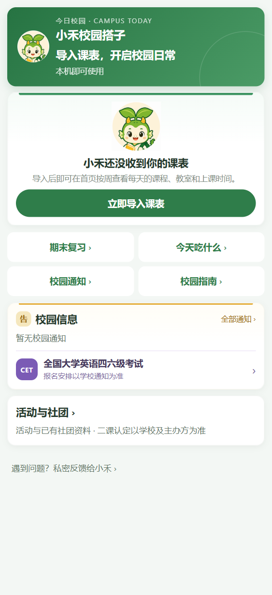
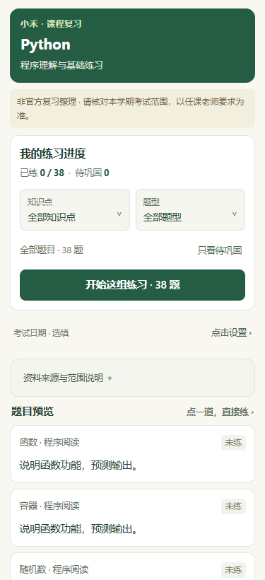

# 小禾校园搭子 | 校园服务微信小程序

**已发布并持续迭代的个人项目** · 课表管理 · 校园信息 · 美食查询 · 课程复习

围绕学生每天的课程安排和校园生活，把分散的信息与常用工具组织进微信小程序。这个仓库展示产品进展、工程取舍和验证记录，方便了解我在需求梳理、AI 协作开发、接口联调、异常修复及发布维护中的实践。

`微信原生小程序` · `JavaScript / WXML / WXSS` · `Python / FastAPI` · `MySQL` · `Docker` · `微信云托管` · `COS`

## 真实使用情况

根据作者提供的微信小程序后台截图，**面板标注日期为 2026-11-01**：

| 指标 | 数值 | 口径 |
| --- | ---: | --- |
| 累计用户数 | **326** | 截图时后台显示的累计值 |
| 访问人数 | 23 | 面板所示当日访问人数 |
| 打开次数 | 113 | 面板所示当日打开次数，不等于人数 |
| 新增用户 | 1 | 面板所示当日新增用户数 |

这是一次运营快照，不是实时统计，也不将累计用户数表述为日活。原始后台截图含登录信息，因此这里仅列出指标。

## 产品能力

以下依据本地项目和近期验收资料整理；小程序已有线上版本，近期本地改动是否全部进入线上版本未逐项核对。

| 模块 | 已有实现与关注点 |
| --- | --- |
| 课表管理 | 课表文字导入、预览确认、手动新增与编辑；处理周次和单双周信息，区分本机保存、云同步与页面跳转结果。 |
| 校园信息 | 校园通知、活动与社团信息浏览；已认证发布者在权限范围内维护活动，包含内容检查与操作审计。 |
| 美食查询 | 店铺资料浏览、位置与价格参考、资料分享和本机“想吃”清单；当前定位为资料查询，不提供点餐交易，旧评价与评分已停止公开。 |
| 课程复习 | Python、Web 等课程复习页面，提供题目筛选、练习进度、待巩固标记与继续练习；资料属于非官方学习整理。 |
| 反馈与恢复 | 针对存储失败、网络异常、同步冲突和跳转失败分别提示，保留用户输入并提供重试入口。 |

## 界面预览

<table>
<tr><th>首页：常用服务入口</th><th>复习：课程与练习进度</th></tr>
<tr>
<td valign="top"></td>
<td valign="top"></td>
</tr>
</table>

以上为近期实际页面的**本地布局检查图**，分别来自 2026-10-29 和 2026-10-26；用于展示界面实现，不代表线上实时内容或全部功能已通过真机验收。

## 我负责的工作

- **需求与取舍：** 梳理校园场景，确定功能范围和迭代优先级，准备内容资料，通过实际使用反馈调整流程。
- **AI 协作开发：** 使用 Codex 辅助分模块编写代码与回归测试，负责提出约束、反馈问题并核对交付结果。
- **联调与维护：** 参与小程序、FastAPI、MySQL 及云服务联调，处理数据保存、资源访问和异常恢复问题。
- **验证与发布：** 结合自动化测试、模拟器和手机体验核对功能，参与 Docker 云托管部署、隐私说明配置和版本提审。

## 一个具体修复：保存成功后返回失败，如何避免重复新增？

**现象：** 课程已保存，但返回课表页失败；用户再次点击保存，可能把同一课程再写一遍。

**处理：** 将本机写入、云同步和页面跳转拆成不同状态。本机写入成功后记录 `saved`，再次操作只重试导航；本机存储失败则保留表单。云同步失败时提示“本机已生效”，不把它混同为保存失败。

**验证：** 本地验收记录包含手动新增计数、编辑不重复新增；另有 2026-10-29 前端测试记录 **548 项通过、0 失败**。这些是历史验证结果，本次展示更新未重新执行业务测试。

[查看工程案例、同步与权限设计、验证范围 →](docs/engineering-notes.md)

## 技术组织

| 层次 | 职责 |
| --- | --- |
| 小程序客户端 | 页面交互、本机课表与复习状态、云调用、错误提示与重试 |
| FastAPI 服务 | 课表解析、身份确认、课表快照及校园内容接口 |
| MySQL | 按用户隔离的课表快照、校园内容、发布权限与审计等业务数据 |
| 微信云托管 / Docker | 服务打包、部署与可信身份链路 |
| COS 与内容检查 | 图片资源存储、访问及发布前内容检查 |

课表快照使用版本号检查更新冲突；发布权限由服务端判断。工程关注点包括状态一致性、输入校验、访问范围和失败恢复。

## 体验与仓库范围

可在微信搜索 **“小禾校园搭子”** 查看已发布版本。

本仓库用于求职展示，未公开完整小程序、后端源码及运行配置，不提供完整产品的一键部署。仓库地址沿用历史名称，根目录的 `index.html`、`styles.css`、`app.mjs` 为早期存档，不作为当前产品的体验入口或功能依据。

联系：[Rongxu1126@foxmail.com](mailto:Rongxu1126@foxmail.com) · [返回个人主页](https://github.com/chenrongxu1010-web)
